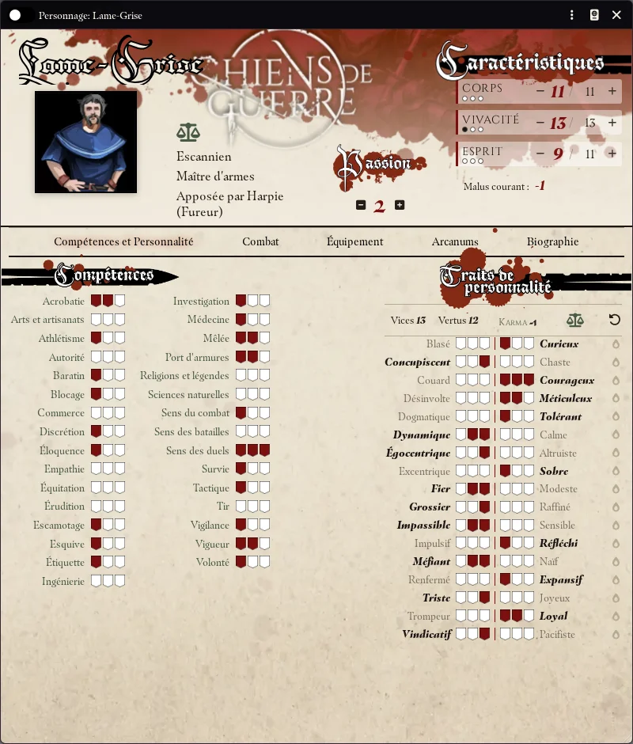

# Système Chiens de guerre pour Foundry VTT

# Disclaimer

Chiens de guerre © 2006-2026 est un jeu de rôle d'Alexandre Ecuvillon, édité par Les XII Singes © 2006-2026.

La marque Chiens de guerre, le logo Chiens de guerre, la marque Les XII Singes et le logo Les XII Singes sont la propriété de ReSpell ©. www.les12singes.com

Les visuels utilisés sur Foundry VTT sont issus des ouvrages Chiens de guerre. Ils sont fournis pour l'utilisation de Foundry VTT. Toute autre utilisation ou reproduction d'image doit obtenir l'accord de ReSpell / Les XII Singes.

# Contribution

Ce système est développé par Khrystov et Khaali.

# Fonctionnalités

## Général

  - Guide du système : compendium « Guide du système », illustré, qui présente la création, les fiches, les objets, les PNJ, la compagnie, les tests, le combat, les batailles et les outils du meneur
  - Langue : le système est en français
  - Onglet Chiens de guerre dans la barre latérale : création de personnage, création de compagnie, bataille, tableau de bord des joueurs
  - Grille configurée en mètres (1,5 m par case)
  - Portrait du personnage dans l'en-tête des messages du tchat
  - Compatible Foundry VTT v14

## Création de personnage

  - Assistant en neuf étapes, dans l'ordre du livre : caractéristiques, origine, carrière et grade, ascendance, compétences, traits de personnalité, personnalisation, touches finales, identité
  - Navigation libre entre les étapes, avec ce qu'il reste à faire à chacune
  - Peuples, carrières, ascendances et arcanums choisis parmi les objets du monde et des compendiums, ou déposés sur la fenêtre
  - Budgets tenus d'office : points de caractéristique, points de compétence, points de personnalisation, langues, rangs accordés par la carrière
  - Rien n'est créé dans le monde avant le dernier bouton

## Fiches de personnage

  - Caractéristiques : Corps, Vivacité et Esprit, chacune avec sa réserve et son maximum
  - 31 compétences notées par écussons, du rang 0 au rang 3
  - 17 couples de traits de personnalité (vice / vertu), totaux, karma et allégeance calculés
  - Jetons de passion, esquives et parade du round, blessures légères, graves et mortelles avec malus courant
  - Dépôt d'un peuple, d'une carrière ou d'une ascendance : traits, langues, compétences, arcanums et équipement accordés d'un coup
  - Inventaire, bourse et solde mensuelle selon le grade, arcanums, langues, expérience, biographie
  - Slider Lecture/Écriture : bascule entre mode consultation (verrouillé) et mode édition

## Objets

  - Équipement : armes, armures, boucliers et objets divers, avec qualité exceptionnelle (+1 dans un domaine choisi)
  - Malus d'initiative des armures et boucliers, doublé sans le rang de Port d'armures requis
  - Arcanums physiques (bonus constant par rang) et mystiques (trois tours de magie, coût en Esprit selon l'allégeance)
  - Traits spéciaux portés par des effets actifs, dont un type maison de bonus circonstanciel proposé à cocher dans la fenêtre de test

## Jets de dés

  - Tests à poignée de d20 sous le seuil de réussite : le meilleur dé est le plus haut sous le seuil, l'égaler est une réussite critique
  - Qualité de la réussite : « Oui, mais… » de 1 à 5, « Oui » à partir de 6, « Oui, et… » sur une réussite critique
  - Fenêtre de test : couple caractéristique / compétence, difficulté, effort, passion, malus de blessure, bonus circonstanciels
  - Se dépasser : un second jet, une fois par test, contre un point dans chaque réserve
  - Le meneur peut changer le dé conservé sur la carte du tchat

## Combat

  - Deux cadences : escarmouche (chaque action coûte 10 points d'initiative) et duel
  - Initiative lancée depuis la fiche, avant ou pendant le combat, avec effort, passion et malus
  - Confrontation : attaque, défense, dégâts et encaissement dans un seul message du tchat, blessure appliquée automatiquement
  - Côté meneur, les boutons qui reviennent aux joueurs sont en retrait pour que ceux des PNJ ressortent
  - Confrontation résolue repliée et signalée
  - Personnage mourant : rappel du jet de survie à chaque fin de round ; PNJ mourant mis hors de combat

## Fiches de PNJ / Créatures

  - Bloc de statistiques du livre sur un seul écran : caractéristiques, compétences, armes, armure, initiative, blessures, règles spéciales
  - Compétences de combat en tête ; en lecture, seules les compétences renseignées
  - Case PNJ majeur : réserves et effort, comme un personnage
  - Bestiaire inclus (PNJ types et créatures), réservé au meneur

## Compagnie franche

  - Assistant de création en trois étapes : caractéristiques, compétences, identité
  - Effectifs, Logistique et Moral, 18 compétences, blessés et chroniques
  - Roster des personnages joueurs et non joueurs, liés aux acteurs, avec le grade de chacun
  - Guérison et repos de la compagnie, dissolution et réactivation
  - Batailles rangées, depuis l'en-tête de la fiche (voir ci-dessous)

## Batailles

  - Fenêtre de bataille par compagnie franche, ouverte depuis la barre latérale, la fiche de la compagnie ou le tchat
  - Préparation par le meneur : enjeu, modificateur de bataille, armée adverse, général adverse (PNJ déposé ou saisi), chef d'armée
  - Tours de cinq phases jusqu'à trois points de victoire : localisation, déroulement des combats, actions d'éclat, opposition des généraux, pertes
  - Chaque joueur place son personnage et lance ses tests de chez lui ; le meneur seul fait avancer la bataille
  - Carte de conséquences par personnage : encaissement, tirage de l'adversaire, escarmouche d'un round avec jeton et combat créés puis retirés, action d'éclat
  - Opposition des généraux et pertes de la compagnie appliquées d'office
  - Récapitulatif dans le tchat et archive dans le journal des batailles de la compagnie
  - Table des adversaires modifiable dans les réglages

## Macros & Hotbar

  - Drag-and-drop des caractéristiques, des compétences, des armes, de l'initiative, de l'esquive, de la parade et de l'encaissement vers la hotbar
  - Arme : Clic = attaque (confrontation si une cible est désignée), Maj+Clic = dégâts
  - Une macro agit sur le token sélectionné, ou à défaut sur le personnage attribué au joueur

## Compendiums

  - Peuples, Traits spéciaux, Carrières, Arcanums, Équipement, Ascendances, Bestiaire — PNJ / Créatures, Guide du système

# Communauté

Rejoignez-nous sur le serveur <a href="https://discord.gg/lafonderie">Discord francophone dédié à Foundry Virtual Tabletop</a> 
Nous serons ravis d'y avoir vos retours sur le système, des signalements de bug, des idées d'amélioration, ou simplement des encouragements !

# Licences
<ul>
<li>Le code HTML, CSS et Javascript de ce projet est placé sous <a href="https://choosealicense.com/licenses/agpl-3.0/">licence GNU Affero General Public License v3.0</a></li>

<li>All HTML, CSS and Javascript in this project is licensed under <a href="https://choosealicense.com/licenses/agpl-3.0/">GNU Affero General Public License v3.0</a></li>

<li>Foundry VTT support is covered by the following license: <a href="https://foundryvtt.com/article/license/">Limited License Agreement for module development 17/02/2021</a>.</li>
</ul>
